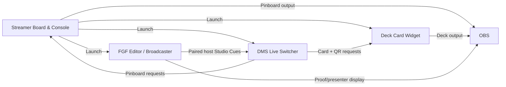

<div align="center">

# 🖥️ Streamer Board & Console
### One local control desk for the rest of your stream.

**A modular desktop hub for app launching, studio profiles, reusable pinboards, and OBS-friendly creator utilities.**

[](https://python.org) [](#getting-started) [](#apps-and-adapters) [](#release-status)

**[Features](#what-you-can-do) · [Install](#getting-started) · [Rename apps](#rename-app) · [FGF launchers](#field-guide-forge-launchers) · [Integrations](#connected-studio-workflow)**

</div>

---

## Overview

**Streamer Board & Console (SBC)** is the central desktop workspace for reusable streamer utilities. It provides one place to discover and start registered apps, manage workflows and studio profiles, and work with saved pinboards rather than scattering every function across separate windows.

Its app-adapter system is designed to keep each utility independent. An adapter identifies how a tool starts; it can be given a friendly display name without altering its underlying identity. **Rename App** on the Apps tab, includes support for human-readable names for Field Guide Forge and custom episode launchers.

## What you can do

| Area | Purpose |
|:--|:--|
| Dashboard | See registered/running apps and resource information |
| Apps | Launch and manage adapters, now with editable display names |
| Hotkeys | Configure available global or app-level shortcuts |
| Pin Boards | Create/load reusable boards and sticker layouts (`.sboard`) |
| Studio Profiles | Group applications and studio behavior into reusable setups |
| Backup / Migrate | Move or preserve supported user configuration |
| Doctor | Inspect supported application setup and dependencies |
| Console Copier / Release Prep | Utilities for debugging and release workflows |

The exact tabs and capabilities may vary with the current alpha source and the installed adapters.

## Getting started

### Requirements

- Python 3 and Tkinter, plus the dependencies declared in this repository's setup files.
- A local desktop environment. Optional connected tools must be installed separately.

```bash
# From a Streamer-Board-Console checkout
python3 streamer_board_console.py
```

If your checkout includes a documented launcher or setup script, prefer it. Use the **Apps** tab to register or locate supported tools instead of editing Python source to hardcode private machine paths.

## Apps and adapters

An adapter defines a stable application key, its command or path, and optional presentation/configuration data. The core program can display a user-friendly label while retaining the adapter's stable ID for profile and automation relationships.

### Rename App

1. Open **Apps** and select a registered application.
2. Choose **Rename App**.
3. Enter the label you'd like the SBC UI to show, such as **Newest Episode FGF** or **3DCP Broadcaster**.
4. Save and verify the application still launches.

The rename updates only the adapter's `display_name`, **not** its stable ID, executable, pinboard links or Studio Profile references. The local adapter JSON is user-owned; keep real adapters containing personal paths out of GitHub. The alpha ships this behavior through the main source and `sbc_app_names.py`.

## Field Guide Forge launchers

**[Field Guide Forge](https://github.com/DigiMancer3D/Field-Guide-Forge)** can be launched from its normal `launch.sh` entry point. An optional native **FGF-BCL** utility generates show-specific broadcaster scripts (for example `3DCP_BCLaunch.sh`) that find the newest eligible *host/private* FGF episode HTML whenever launched.

Recommended SBC setup:

| Adapter | Target | Label suggestion |
|:--|:--|:--|
| FGF editor | Existing `FGF/launch.sh` on the user's machine | `FGF Editor` |
| FGF broadcaster | Generated `*_BCLaunch.sh` | `Newest Episode FGF` |
| DMS | Installed DMS launcher | `DMS Live Switcher` |
| Deck Card Widget | Installed DCW launcher | `Deck Card Widget` |

Don't commit actual absolute paths as generic templates. Each user should select their own app locations and show directories.

## Connected studio workflow



DMS handles validated deck and pinboard selection. SBC keeps its role as the app and pinboard control hub. No tool requires public Internet access to send local studio switching requests.

## Repository organization

| Source path | Purpose |
|:--|:--|
| `streamer_board_console.py` | Main application/controller |
| `sbc_app_names.py` | User-visible adapter rename helper |
| `sbc_core/` | Shared core support where present |
| `adapter_templates/` | Safe starter configurations |
| `adapters/` | Adapter definitions; review carefully before publishing |
| `docs/`, `assets/` | Help, visuals, troubleshooting and supporting material |

**Important:** A folder name in this table describes a known component of the project family, not a guarantee that the folder is present in every commit.

## Data protection & backups

User profiles, real app adapters, personal paths and pinboard collections belong **outside public source releases** unless deliberately sanitized. Don't publish `user_data/`, active `.sboard` saves, pairing tokens, show-specific labels with private paths, or dated backup files. Back up relevant local configuration before switching alpha versions.

When distributing adapter examples, use a generic user-configurable path instead of the developer's `HOME` directory.

## Troubleshooting

<details><summary><strong>Rename App is missing</strong></summary>

Verify the installed `streamer_board_console.py` matches the new `sbc_app_names.py` helper, restart SBC, and check the **Apps** tab. Updating only the helper file is not sufficient.

</details>

<details><summary><strong>The renamed application doesn't start</strong></summary>

The label does not change the executable command. Recheck the adapter's configured launch target and permissions.

</details>

<details><summary><strong>FGF-BCL opens the wrong episode</strong></summary>

Review its configured show-name priorities, `EP` detection pattern, and private/broadcast filename filters. SBC launches the generated script; FGF-BCL chooses the episode.

</details>


## Ecosystem

[DMST](https://github.com/DigiMancer3D/DMST) · [DMS Live Switcher](https://github.com/DigiMancer3D/DMS-Live-Switcher) · [Deck Card Widget](https://github.com/DigiMancer3D/Deck-Card-Widget) · [Field Guide Forge](https://github.com/DigiMancer3D/Field-Guide-Forge)

Made by **[DigiMancer3D](https://github.com/DigiMancer3D)**


